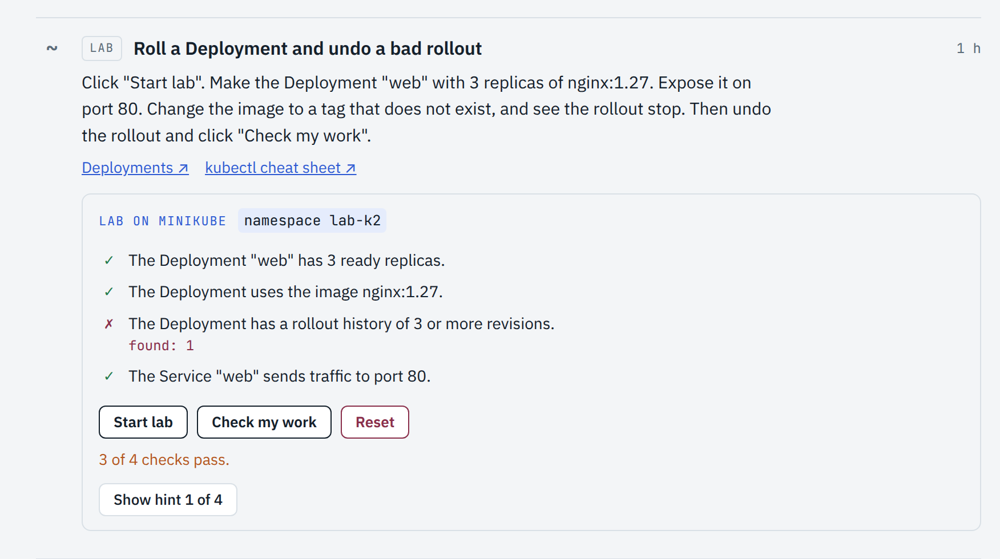
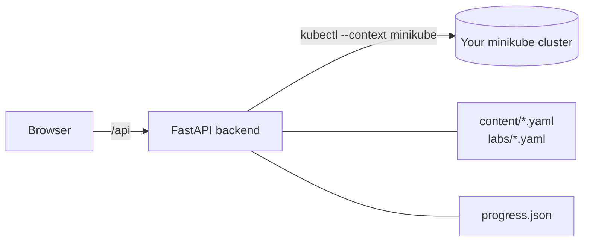

<div align="center">

# KubeTrail

**Learn Kubernetes on a real cluster on your Mac.**<br>
You type the `kubectl` commands. The app checks your cluster and shows what passes.

[](https://github.com/spillows/kubetrail/actions/workflows/test.yml)


[](LICENSE)

[Quickstart](#quickstart) · [What you learn](#what-you-learn) · [How a lab works](#how-a-lab-works) · [Safety](#safety) · [Troubleshooting](#troubleshooting) · [Roadmap](ROADMAP.md)


</div>

## Why KubeTrail

- **A real cluster, not a simulator.** The labs run on your own minikube. You use the same commands that you use at work.
- **The app checks your work.** "Check my work" reads the cluster with `kubectl` and shows each check that passes or fails. You cannot mark a lab done by hand.
- **Safe by design.** The app talks only to a minikube context, and it changes only the `lab-*` namespaces that it made. [More about the guard](#safety).
- **Local and free.** No account, no cloud and no API key. Your progress is in one file, `progress.json`.

## Quickstart

You need a Mac with [Homebrew](https://brew.sh).

```sh
brew install --cask docker                    # open Docker.app one time, and keep it running
brew install minikube kubectl python@3.12

git clone https://github.com/spillows/kubetrail.git
cd kubetrail
minikube start --driver=docker --cni=calico
./run.sh
```

Calico gives the cluster NetworkPolicy support. The NetworkPolicy lab needs it.
The Gateway lab (k15) needs Envoy Gateway. Its lab panel gives the install commands.

`./run.sh` makes a virtual environment in `.venv`, installs the app and runs the doctor (`scripts/doctor.py`).
Then it starts the server and opens http://127.0.0.1:8000. Press Ctrl+C to stop it.
The next start skips the install, unless `pyproject.toml` changed.

| Option | What it does |
| --- | --- |
| `PORT=8001 ./run.sh` | Uses a different port. |
| `MQ_NO_BROWSER=1 ./run.sh` | Does not open the browser. |

> [!NOTE]
> The `python3` that comes with macOS is Python 3.9. The app needs Python 3.11 or newer, so install `python@3.12` with Homebrew. `./run.sh` finds it for you.

## What you learn

The MVP has one act, **Pods, Deployments, Services**, with three quests:

| | Quest | Type | Time | You are done when |
| --- | --- | --- | --- | --- |
| 1 | Read about Pods, Deployments and Services | READ | 45 min | You click "Mark done". |
| 2 | Run your first Pod | LAB | 20 min | The Pod `hello` runs `nginx:1.27` with the label `app=hello`. |
| 3 | Roll a Deployment and undo a bad rollout | LAB | 1 h | The Deployment `web` has 3 ready replicas, a Service on port 80, and a rollback in its history. |

The course grows to twelve acts: Kubernetes, then Helm, then Terraform, then a capstone, then advanced Kubernetes. [`docs/designs/course-expansion.md`](docs/designs/course-expansion.md) is the catalog. [ROADMAP.md](ROADMAP.md) has the work after it.

## How a lab works



1. Click **Start lab**. The app makes the lab namespace, for example `lab-k2`. Then run the command that the panel shows. It makes the lab namespace your default, so your `kubectl` commands go there.
2. Do the task in your terminal with `kubectl`.
3. Click **Check my work**. Each check shows ✓ or ✗. A failed check shows the value that the app found.
   When all checks pass, the app marks the quest done.
4. Stuck? Click **Show hint**. The hints come one at a time.
5. To start the lab again, click **Reset** two times in 5 seconds. This deletes the lab namespace.

## Safety

The app changes only your local minikube cluster. These are the rules:

- The current kubectl context must be a minikube profile. If it is not, the app refuses the call and the page tells you how to fix it.
- Each `kubectl` call has the `--context` flag. If you change the context during a lab, the app still sends its calls to minikube.
- The app changes only the namespaces that it made. They have the label `app.kubernetes.io/managed-by=kubetrail`.
- Setup and reset refuse a namespace without this label.
- The app does not change your kubectl context or your default namespace.
- The app never reads or writes your files, and never runs `helm` or `terraform`.

The guard covers the calls of the app. It does not cover the commands that you type. Check your context before you run a command that deletes objects.

## Troubleshooting

Run the doctor at any time. It examines Python, minikube, kubectl, Docker, the minikube profile, the kubectl context and the Python packages. It does not change anything.

```sh
.venv/bin/python scripts/doctor.py
```

Each WARN and FAIL line has one line of help below it.

<details>
<summary><b>The page says that the context is not a minikube profile</b></summary>

Run `kubectl config use-context minikube` (or the name of your profile), then reload the page.
If kubectl has no current context at all, `minikube stop` removed it. Run `minikube start`.
</details>

<details>
<summary><b>minikube is not running</b></summary>

Open Docker.app, then run `minikube start --driver=docker --cni=calico`.
</details>

<details>
<summary><b>Port 8000 is in use</b></summary>

Stop the other server, or run `PORT=8001 ./run.sh`.
</details>

<details>
<summary><b>The checks say "not found", but I made the object</b></summary>

You made it in a different namespace, usually `default`. The panel says where it found the object. Delete it there, run `kubectl config set-context --current --namespace lab-k3` (use the lab's namespace), then do the task again.
</details>

<details>
<summary><b>Start lab says that KubeTrail did not make the namespace</b></summary>

A namespace with the lab's name exists, but it does not have the app's label, so the app does not touch it. Delete it yourself, for example `kubectl delete namespace lab-k2`, then click Start lab again.
</details>

<details>
<summary><b>I want to start again with no progress</b></summary>

Stop the server and delete `progress.json`. If the file is not valid JSON, the app does not write over it. Repair the file or move it away.
</details>

## How it is built



- `backend/`: a FastAPI app. It serves the API under `/api` and the frontend at `/`.
- `frontend/`: plain ES modules and CSS. There is no build step.
- `content/`: the acts and quests, as YAML.
- `labs/`: one YAML file for each lab, with its setup objects, checks and hints.
- `tests/e2e/`: a machine solution for each lab, and the end-to-end test that runs them on a real minikube.

The last passing end-to-end run used minikube v1.39.0 and Kubernetes v1.37.0, with Calico.

## Contributing

To add a quest or a lab, or to run the tests, see [CONTRIBUTING.md](CONTRIBUTING.md).

## License

[MIT](LICENSE)
