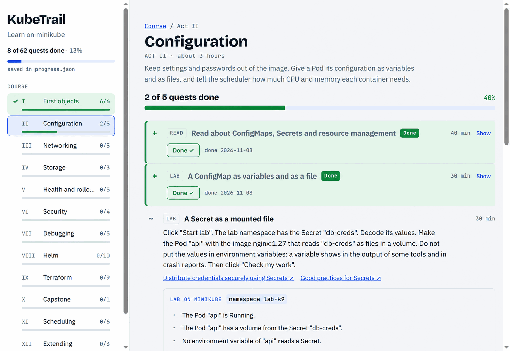
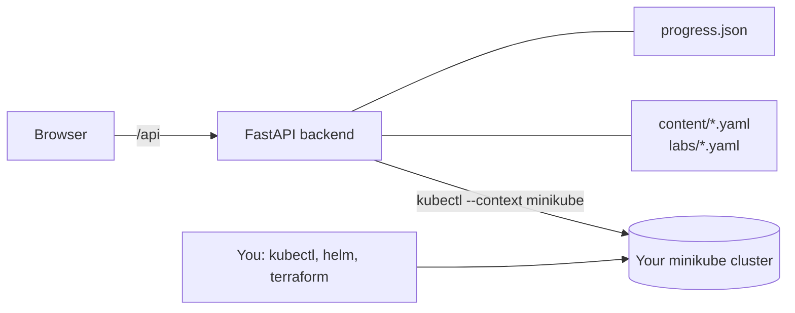

<div align="center">

# KubeTrail

**Learn Kubernetes, Helm and Terraform on a real cluster on your Mac.**<br>
You type the commands. The app checks your cluster and shows what passes.

[](https://github.com/spillows/kubetrail/actions/workflows/test.yml)


[](LICENSE)

[Quickstart](#quickstart) · [What you learn](#what-you-learn) · [How a lab works](#how-a-lab-works) · [Safety](#safety) · [Troubleshooting](#troubleshooting) · [Roadmap](ROADMAP.md)



</div>

## Why KubeTrail

- **A real cluster, not a simulator.** The labs run on your own minikube. You use the same `kubectl`, `helm` and `terraform` commands that you use at work.
- **The app checks your work.** "Check my work" reads the cluster with `kubectl` and shows each check that passes or fails. You cannot mark a lab done by hand.
- **Safe by design.** The app talks only to a minikube context, and it changes only the `lab-*` namespaces that it made. [More about the guard](#safety).
- **Local and free.** No account, no cloud and no API key. Your progress is in one file, `progress.json`.

## Quickstart

You need a Mac with [Homebrew](https://brew.sh).

```sh
brew install --cask docker                    # open Docker.app one time, and keep it running
brew install minikube kubectl python@3.12

git clone https://github.com/spillows/kubetrail.git
cd kubetrail
minikube start --driver=docker --cni=calico
./run.sh
```

Calico gives the cluster NetworkPolicy support. The NetworkPolicy lab needs it.

`./run.sh` makes a virtual environment in `.venv`, installs the app and runs the doctor (`scripts/doctor.py`).
Then it starts the server and opens http://127.0.0.1:8000. Press Ctrl+C to stop it.
The next start skips the install, unless `pyproject.toml` changed.

| Option | What it does |
| --- | --- |
| `PORT=8001 ./run.sh` | Uses a different port. |
| `KT_NO_BROWSER=1 ./run.sh` | Does not open the browser. |

> [!NOTE]
> The `python3` that comes with macOS is Python 3.9. The app needs Python 3.11 or newer, so install `python@3.12` with Homebrew. `./run.sh` finds it for you.

### Tools and cluster features for some acts

Acts I to VII need only the setup above. Some labs need more. You can install each item when you get to its act.

| Item | Used by | How to get it |
| --- | --- | --- |
| `helm` | Act VIII | `brew install helm` |
| `terraform` | Acts IX and X | `brew install hashicorp/tap/terraform` |
| metrics-server | Act V, the autoscaler lab (k24) | `minikube addons enable metrics-server` |
| Envoy Gateway | Act III, the Gateway lab (k15) | The lab panel gives the commands. They use `install/gateway.yaml`. |
| The `kt-multi` profile, with 3 nodes | Act XI | `minikube start -p kt-multi --driver=docker --cni=calico --nodes=3`, then `kubectl config use-context kt-multi` |

If a lab needs an item that is not there, the app disables **Start lab** and the panel shows the command to run.

## What you learn

The course has twelve acts and 62 quests: 13 READ quests, 41 LAB quests and 8 BOSS labs.

| Act | Title | Quests | Time | You learn |
| --- | --- | --- | --- | --- |
| I | First objects | 6 | about 4 h | Pods, Deployments and rollbacks, Services, Jobs and CronJobs, init containers and sidecars |
| II | Configuration | 5 | about 3 h | ConfigMaps, Secrets, requests and limits, QoS classes, ResourceQuotas |
| III | Networking | 5 | about 3 h | ClusterIP and NodePort, DNS names, the Gateway API, NetworkPolicy |
| IV | Storage | 3 | about 2 h | PersistentVolumeClaims, StatefulSets with a headless Service |
| V | Health and rollouts | 5 | about 3 h | Probes, `maxSurge` and `maxUnavailable`, PodDisruptionBudgets, the HorizontalPodAutoscaler |
| VI | Security | 4 | about 3 h | ServiceAccounts and RBAC, security contexts, the restricted Pod Security level |
| VII | Debugging | 5 | about 4 h | Five broken apps to repair with `get`, `describe`, `logs` and events |
| VIII | Helm | 10 | about 6 h | Releases and rollbacks, values, subcharts, hooks, `helm test`, atomic upgrades, a broken chart |
| IX | Terraform | 9 | about 6 h | The Kubernetes backend, variables and `for_each`, modules, workspaces, data sources, `destroy` |
| X | Capstone | 1 | about 1 h | Terraform installs a Helm release of the Act VIII chart |
| XI | Scheduling | 6 | about 4 h | Node affinity, anti-affinity and topology spread, taints, DaemonSets, cordon and drain |
| XII | Extending | 3 | about 2 h | CRDs and custom resources, the control plane |

Do the Act XI labs in order. Each lab starts from the node state of the lab before it.

[`docs/designs/course-expansion.md`](docs/designs/course-expansion.md) is the design of the course. [ROADMAP.md](ROADMAP.md) has the work after it.

## How a lab works


1. Click **Start lab**. The app makes the lab namespace, for example `lab-k2`. Then run the command that the panel shows. It makes the lab namespace your default, so your `kubectl` commands go there.
2. Do the task in your terminal. In a Helm or Terraform lab, put your files in `workspace/<lab id>/`, for example `workspace/t2/`. Git ignores your files there.
3. Click **Check my work**. Each check shows ✓ or ✗. A failed check shows the value that the app found.
   When all checks pass, the app marks the quest done.
4. Stuck? Click **Show hint**. The hints come one at a time.
5. To start the lab again, click **Reset** two times in 5 seconds. This deletes the lab namespace.

A READ quest has links to read and a task. Click **Mark done** when you finish it.

## Safety

The app changes only your local minikube cluster. These are the rules:

- The current kubectl context must be a minikube profile. If it is not, the app refuses the call and the page tells you how to fix it.
- Each `kubectl` call has the `--context` flag. If you change the context during a lab, the app still sends its calls to minikube.
- The app changes only the namespaces that it made. They have the label `app.kubernetes.io/managed-by=kubetrail`.
- Setup and reset refuse a namespace without this label.
- The app does not change your kubectl context or your default namespace.
- The app does not read or write your files. It writes only `progress.json`.
- The app does not run `helm` or `terraform` to change the cluster. You run them. The doctor runs only `helm version` and `terraform version`, and the checks read the result from the cluster.

The guard covers the calls of the app. It does not cover the commands that you type. Check your context before you run a command that deletes objects.

## Troubleshooting

Run the doctor at any time. It examines Python, minikube, kubectl, Docker, the minikube profile, the kubectl context, the Python packages, `helm`, `terraform`, Calico and the Kubernetes version. It does not change anything.

```sh
.venv/bin/python scripts/doctor.py
```

Each WARN and FAIL line has one line of help below it. A missing `helm` or `terraform` is a WARN, because only some acts need it.

<details>
<summary><b>The page says that the context is not a minikube profile</b></summary>

Run `kubectl config use-context minikube` (or the name of your profile), then reload the page.
If kubectl has no current context at all, `minikube stop` removed it. Run `minikube start`.
</details>

<details>
<summary><b>minikube is not running</b></summary>

Open Docker.app, then run `minikube start --driver=docker --cni=calico`.
</details>

<details>
<summary><b>Port 8000 is in use</b></summary>

Stop the other server, or run `PORT=8001 ./run.sh`.
</details>

<details>
<summary><b>Start lab is disabled</b></summary>

The lab needs a tool or a cluster feature that is not there. The panel gives the command to run. See [Tools and cluster features for some acts](#tools-and-cluster-features-for-some-acts).
If you installed `helm` or `terraform` after you started the server, stop the server and run `./run.sh` again, so that the server finds the tool on its `PATH`.
</details>

<details>
<summary><b>An Act XI lab says that it needs 3 nodes</b></summary>

Start the `kt-multi` profile: `minikube start -p kt-multi --driver=docker --cni=calico --nodes=3`. Then run `kubectl config use-context kt-multi` and reload the page.
To go back to the other acts, run `kubectl config use-context minikube`.
</details>

<details>
<summary><b>The checks say "not found", but I made the object</b></summary>

You made it in a different namespace, usually `default`. The panel says where it found the object. Delete it there, run `kubectl config set-context --current --namespace lab-k3` (use the lab's namespace), then do the task again.
</details>

<details>
<summary><b>Start lab says that KubeTrail did not make the namespace</b></summary>

A namespace with the lab's name exists, but it does not have the app's label, so the app does not touch it. Delete it yourself, for example `kubectl delete namespace lab-k2`, then click Start lab again.
</details>

<details>
<summary><b>I want to start again with no progress</b></summary>

Stop the server and delete `progress.json`. If the file is not valid JSON, the app does not write over it. Repair the file or move it away.
</details>

## How it is built



- `backend/`: a FastAPI app. It serves the API under `/api` and the frontend at `/`.
- `frontend/`: plain ES modules and CSS. There is no build step.
- `content/`: the acts and quests, as YAML. `content/index.yaml` gives the order of the acts.
- `labs/`: one YAML file for each lab, with its needs, setup objects, checks and hints.
- `charts/`: the Helm charts that the Helm labs and the capstone use.
- `workspace/`: one folder for each Terraform lab, with its `versions.tf` and `providers.tf`. You write the rest.
- `install/`: the GatewayClass for the Gateway lab.
- `scripts/doctor.py`: the doctor.
- `tests/e2e/`: a machine solution for each lab, and the end-to-end test that runs them on a real minikube.

The last passing end-to-end run used minikube v1.39.0 and Kubernetes v1.37.0, with Calico.

## Contributing

To add a quest or a lab, or to run the tests, see [CONTRIBUTING.md](CONTRIBUTING.md).

## License

[MIT](LICENSE)
