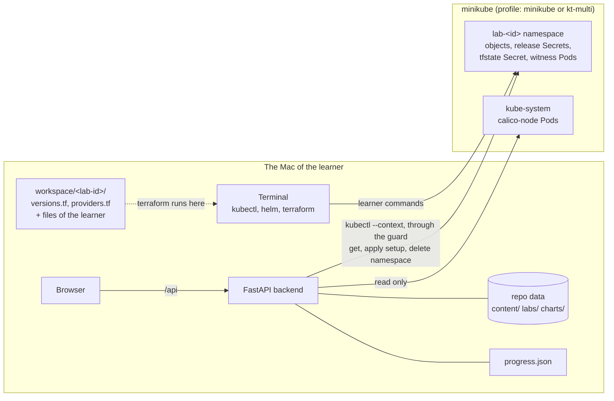

# KubeTrail: a full course for Kubernetes, Helm and Terraform

*   **Author:** Shadow-AI
*   **Status:** Implemented
*   **Date:** 2026-11-08

--------------------------------------------------------------------------------

## Overview

KubeTrail is a web app that runs on the computer of the learner. It
teaches Kubernetes on a local minikube cluster. The learner does a task in a
terminal. The app reads the cluster. The app says if the task is complete.

This design grows the app from three quests to a course of about 62 quests.
The course has these parts, in page order:

1.  Kubernetes, novice to intermediate (Acts I to VII).
2.  Helm.
3.  Terraform.
4.  A capstone: Terraform installs a Helm release on the cluster.
5.  Kubernetes, advanced (Acts XI and XII), on a second minikube profile.

The app does not explain the subjects. READ quests link to the official
documents, which are the source of truth. LAB and BOSS quests state an end
state. The learner reaches it. The app proves it.

The app reads Kubernetes objects only. It does not read the files of the
learner. It does not run `helm` or `terraform`. Helm and Terraform leave
objects in the lab namespace, and the app reads those objects.

This document is the catalog of record. Each pull request that adds or changes
a lab also updates the entry for that lab in this document.

`ROADMAP.md` holds the work after this design.

## The Problem

**Today the app stops at the basics.** It has three quests: one READ quest and
two labs (a Pod, and a Deployment rollout). The engine has one check kind: it
reads one field of one object in the lab namespace with `kubectl get` and a
JSONPath expression. The Helm and Terraform acts that existed before the MVP
were one-line task stubs with links. The MVP removed them.

**Other tutorials do not check the work on the cluster of the learner.** The
official tutorials explain. Browser sandboxes give a cluster that disappears.
Nothing checks that a learner reached the end state on a real, local cluster
that the learner controls, across Kubernetes, Helm and Terraform, and then
shows how the three tools work together.

**The app has a safety model that the growth must keep.** The app touches only
a minikube context. It changes only the `lab-*` namespaces that it made and
stamped. It never reads the files of the learner. Helm and Terraform make this
harder:

*   Helm and Terraform keep their state in places that look outside the
    cluster.
*   Terraform runs as the learner, with the kubeconfig of the learner. The
    guard of the app does not cover it.
*   Some advanced topics change cluster-scoped objects (nodes, CRDs). Reset
    cannot remove them.
*   Some lessons are about behavior (traffic is blocked), not about the fields
    of an object.

**The problem:** cover Kubernetes from novice to advanced, then Helm, then
Terraform, then their integration. Check each lab by machine. Keep the safety
model. Keep the app small enough for one author to maintain.

**The solution, in short:**

*   Helm keeps each release revision in a Secret with stable labels. Terraform
    with the `kubernetes` backend keeps its state in a named Secret. Both
    Secrets are in the lab namespace. The existing check kind reads them.
*   "Witness" Deployments turn behavior into a field: a readiness probe tests
    the behavior, and the app reads `readyReplicas`.
*   "Repair" labs use the existing `setup` field to apply a broken app.
*   Labs that change cluster-scoped objects run only on a second profile,
    `kt-multi`. The learner deletes that profile to clean it.
*   Terraform labs work in `workspace/<lab-id>/`. The repository pins the
    providers and their versions there, and fixes the provider context to the
    minikube profile.
*   The engine gets six small repairs. It gets no new check kind.

## Goals

1.  **A full course.** About 62 quests in the page order of the Overview: about
    33 Kubernetes quests in Acts I to VII, 10 Helm quests, 9 Terraform quests,
    1 capstone, and about 9 Kubernetes quests in Acts XI and XII.
2.  **Each LAB and BOSS quest is checked by machine.** The learner cannot mark
    a lab done by hand.
3.  **Checks read Kubernetes objects only.** Each check reads names, types,
    labels or fields with `kubectl get`, through the context guard, in the lab
    namespace.
4.  **Helm work is proven** from the release Secrets
    (`type: helm.sh/release.v1`, labels `owner`, `name`, `status`, `version`).
    **Terraform work is proven** from the state Secret by name
    (`tfstate-<workspace>-<suffix>`) and from the real objects.
5.  **The safety model does not change.** The app touches only a minikube
    context. It deletes only namespaces that it stamped. It never reads or
    writes the files of the learner. It never runs `helm` or `terraform`.
6.  **A stranger can start.** Act I needs only minikube, kubectl, Docker and
    Python. A lab that needs a missing tool or cluster feature says so before
    Start lab. The app makes no namespace for that lab.
7.  **The wrong-namespace help works for each check**, including checks that
    use a label selector.
8.  **Each lab has a machine solution** and passes the opt-in end-to-end test
    before merge.
9.  **Lab text states an end state.** It gives no command to copy. One
    exception: text that limits the blast radius is given word for word. A
    failed check shows one sentence that says why its end state matters.
10. **A learner can finish the course one time.** At 30 to 60 minutes for each
    quest, the course is about 45 hours.

## Non-Goals

*   No explanation text in the app, except one sentence of `why` for each
    check, shown only when the check fails. No `brief` or `solution` Markdown
    field.
*   No grading of chart or module craft. The app checks effects, not
    authorship.
*   No reading of the files of the learner. No `helm` or `terraform` run by the
    app. No backend file writes. The app never writes to `workspace/`.
*   No reading inside a Helm payload or a Terraform state. No `decode:`
    modifier.
*   No new check kind. No `kind` field on checks. No `command` kind.
*   No `countAtLeast` or `contains` operator until a lab needs one.
*   No defence against a learner who cheats. `progress.json` is a local file.
*   No XP and no ranks.
*   One namespace for each lab, always `lab-<id>`. Terraform never makes a
    namespace.
*   No cluster administration labs: etcd backup, upgrades, certificates.
*   No `quiz` kind in this design. READ quests end with "Mark done".
*   macOS only. No Linux.
*   No hosted service, no accounts, no class management.
*   No labs for a cloud provider.
*   No build step for the frontend.

## Open Questions

*   **Helm 4 storage format.** Helm 4 is the current major version. The checks
    in this design depend on the `sh.helm.release.v1` Secret, its type and its
    labels, as Helm 3 writes them. Confirm that Helm 4 writes the same before
    the first Helm lab. Record the fixtures with Helm 4.
*   **The size of `kt-multi`.** Three nodes and the main profile on one laptop.
    The `--memory` and `--cpus` values for each node are not set. Measure them
    on a real Mac before Act XI.
*   **The Ingress lab and ingress-nginx.** The minikube `ingress` addon
    installs ingress-nginx. The Kubernetes project announced the retirement of
    ingress-nginx in late 2025. Before the Ingress lab is written, confirm what
    the addon installs at that time. If the addon is gone or not maintained,
    the lab teaches the Gateway API in its place, with an implementation that
    minikube can install. Resolved in k15: minikube v1.39 still installs
    ingress-nginx v1.15.1, but the project is retired. k15 teaches the Gateway
    API with Envoy Gateway v1.10.0. `install/gateway.yaml` adds the
    GatewayClass `quest`, with an `EnvoyProxy` that makes the Gateway Service
    a ClusterIP Service named `quest-gateway`. Thus the lab needs no
    `minikube tunnel`, and the witness has a fixed address.
*   **The `kubectl` image for witnesses.** The ServiceAccount lab runs `kubectl`
    in a witness Pod. Bitnami changed its public image catalog in 2025. Choose
    an image from an official registry and pin its tag before that lab is
    written. Resolved in k26: `registry.k8s.io/kubectl:v1.34.1`. The image
    has no shell, thus the witness runs `kubectl proxy` to stay up.

## Critical User Journeys (CUJs)

### CUJ 1: A stranger finishes the first lab

*   **Given**: A Mac with Docker Desktop, Homebrew, minikube, kubectl and
    Python 3.11 or later. The learner cloned the repository and ran
    `minikube start --driver=docker --cni=calico` and `./run.sh`.
*   **When**: The learner opens "Run your first Pod", clicks Start lab, runs the
    namespace command that the panel shows, makes the Pod with `kubectl`, and
    clicks Check my work.
*   **Then**: Each check shows a pass. The app marks the quest done in
    `progress.json`. The page did not show a command that makes the Pod.

### CUJ 2: A Helm lab with no `helm` on the PATH

*   **Given**: The learner finished Act VII. `helm` is not installed.
*   **When**: The learner opens the first Helm lab.
*   **Then**: The lab panel says that the lab needs `helm` and gives the install
    command. Start lab is not available. The app makes no namespace.

### CUJ 3: A Helm release in the wrong namespace

*   **Given**: The learner ran `helm install` without `-n`. The default
    namespace of the kubeconfig was `default`.
*   **When**: The learner clicks Check my work.
*   **Then**: The release checks fail. The panel says that the release is in
    `default`, not in the lab namespace.

### CUJ 4: A Terraform lab, then Reset, then the same lab again

*   **Given**: `terraform` is installed. The learner works in
    `workspace/<lab-id>/`, which holds the committed `versions.tf` and
    `providers.tf`.
*   **When**: The learner writes `backend.tf` and `main.tf`, runs
    `terraform init` and `terraform apply`, and clicks Check my work. Then the
    learner clicks Reset, clicks Start lab, and runs `terraform apply` again.
*   **Then**: The first check passes: the objects exist and the state Secret
    exists by name. Reset deletes the namespace, the objects and the state
    Secret. The second `apply` starts from empty state and the check passes
    again. `git status` shows no file from the learner.

### CUJ 5: An advanced lab on a one-node cluster

*   **Given**: The learner finished the capstone. The current profile has one
    node.
*   **When**: The learner opens the first lab of Act XI.
*   **Then**: The lab panel says that the lab needs three nodes and tells the
    learner to start the `kt-multi` profile. The README warns that the profile
    is heavy on a laptop. After the learner switches to `kt-multi`, Start lab is
    available.

### CUJ 6: The author adds a lab

*   **Given**: The author writes a new lab file, its machine solution, and its
    entry in this document.
*   **When**: The author runs `pytest`, then the opt-in end-to-end test against
    a real cluster.
*   **Then**: `pytest` validates the lab file. The end-to-end test does Start
    lab, applies the solution, runs Check my work with a pass, and does Reset.

## Technical Plan (Architecture)

### What does not change

The shape of the app stays the same. A FastAPI backend serves a JSON API under
`/api` and the static frontend at `/`. The backend runs `kubectl` and
`minikube` as commands, with an argument list and a timeout. Each call that
reads or changes a lab goes through the context guard,
`cluster.require_minikube()`. Setup and Reset change only a namespace with the
label `app.kubernetes.io/managed-by=kubetrail`. There is one check kind:
read one JSONPath value from one kind of object in the lab namespace, then
compare it with one operator.

This design adds data, rules and six repairs. It adds no new check kind and no
new kind of cluster access.

### The system



The learner changes the cluster with the tools. The app reads the result. The
app never reads `workspace/`, and never runs `helm` or `terraform`.

### Three ways to check a lab

All three use the existing check kind.

**State.** The learner makes or changes an object. A check reads a field. This
is how the current labs work.

**Repair.** `setup` applies a broken app, for example a Deployment with an
image that does not exist. The learner finds the fault and repairs it. Checks
read the fields that show a working app: `readyReplicas`, endpoint addresses,
the Pod phase. Checks read EndpointSlices (`discovery.k8s.io/v1`), not
Endpoints. The Endpoints API is deprecated.

**Witness.** Some lessons are about behavior. `setup` applies a small witness
Deployment. Its readiness probe tests the behavior, for example
`wget -q -T1 -O- http://web`. The witness is Ready when the behavior is
present. A check reads `readyReplicas` of the witness. A NetworkPolicy lab uses
two witnesses: one that the policy permits (Ready) and one that it blocks (not
Ready). Witness images have a pinned tag.

### How the app reads Helm work

```text
learner: helm install demo ./charts/demo -n lab-h2
            |
            v
Secret sh.helm.release.v1.demo.v1   type: helm.sh/release.v1
  labels: owner=helm, name=demo, status=deployed, version=1
            |
app: kubectl --context <profile> get secret -n lab-h2
       --selector=owner=helm,name=demo,status=deployed
       -o jsonpath={.items[*].metadata.labels.version}
```

Rules for a Helm check:

*   Select by label. Keep `status=deployed` in the selector. Then only one
    Secret matches. Without that clause, the selector finds each revision, and
    the check needs each value to pass. The check then always fails.
*   Do not name the Secret. The name holds the revision number, which changes
    at each upgrade.
*   A rollback needs two checks: the deployed revision is 3 or more, and the
    Deployment uses the first image again.
*   A Helm lab has an empty `setup`. The app stamps setup objects with
    `app.kubernetes.io/managed-by: kubetrail`. Helm needs the value
    `Helm` on the objects that it owns, so a setup object that the chart also
    makes stops `helm install`. A test enforces this rule.

Each Helm lab uses a chart from `charts/`. A local chart does not change and
needs no network.

**A lab that changes a chart works on a copy.** Some Helm labs ask the learner
to add a template or change one (a hook, a test, a checksum annotation, a
repair). The learner copies the chart to `workspace/<lab-id>/` and works there.
The `.gitignore` rules ignore that copy. Thus the work of the learner never
changes `charts/`. Labs that only install a chart use `charts/` directly.

### How the app reads Terraform work

```text
workspace/t2/versions.tf     (repo)    pins terraform, kubernetes and helm providers
workspace/t2/providers.tf    (repo)    config_context = var.kube_context  (default "minikube")
workspace/t2/backend.tf      (learner) backend "kubernetes" { namespace = "lab-t2",
                                         secret_suffix = "t2", config_context = "minikube" }
workspace/t2/main.tf         (learner) resources
            |
learner: terraform init && terraform apply
            |
            v
Secret tfstate-default-t2 in lab-t2   labels: tfstate=true,
                                      app.kubernetes.io/managed-by=terraform
            |
app: kubectl get secret/tfstate-default-t2 -n lab-t2  (and the real objects)
```

Rules for a Terraform lab:

*   The lab text gives the namespace and the suffix. The suffix is the lab id.
    Thus the state Secret is `tfstate-<workspace>-<lab-id>`.
*   A check names the state Secret. The name is stable. A named check also
    turns on the wrong-namespace help.
*   Other checks read the real objects that Terraform made, by name.
*   A backend block cannot use variables. Thus the lab text gives the
    `config_context` line of the backend word for word.
*   Terraform never makes a namespace. Start lab makes it. After Reset, the
    learner clicks Start lab before `terraform apply`.
*   Reset deletes the state Secret and the lock Lease with the namespace. The
    next `apply` starts from empty state.

`.gitignore` holds:

```text
workspace/*/*
!workspace/*/versions.tf
!workspace/*/providers.tf
```

### The `needs` gate

A lab can declare what it needs. The grammar:

| Token | Met when |
| --- | --- |
| `helm` | `helm` is on the PATH of the backend process. |
| `terraform` | `terraform` is on the PATH of the backend process. |
| `gateway` | The GatewayClass `quest` has the condition `Accepted=True`. The help gives the Envoy Gateway install and `kubectl apply -f install/gateway.yaml`. |
| `addon:<name>` | `minikube addons list` shows the addon as enabled for the current profile. |
| `cni:calico` | `kube-system` has one or more Pods with the label `k8s-app=calico-node`. |
| `nodes:<n>` | The current profile has `n` or more Ready nodes. |

The backend enforces the gate:

```text
GET  /api/needs                 -> {"helm":      {"met": true,  "help": ""},
                                    "terraform": {"met": false, "help": "Run `brew install
                                                  hashicorp/tap/terraform`. The server
                                                  looked in PATH=<...>."},
                                    "nodes:3":   {"met": false, "help": "Start the kt-multi
                                                  profile: ..."}}
POST /api/labs/{id}/setup       -> 400 LabError if a need is not met:
                                   "This lab needs terraform. The server looked in
                                    PATH=<...>. Run `brew install hashicorp/tap/terraform`."
```

*   `GET /api/needs` reads the cluster one time and gives the state of each
    token that a lab uses. The panel disables Start lab and shows the help when
    a need of its lab is not met.
*   `setup()` evaluates the needs again before it makes the namespace. The
    backend is the authority. The panel only shows the result.
*   The tool check uses the PATH of the backend process. That PATH can differ
    from the PATH of the shell of the learner. The refusal names the PATH that
    the server searched, so that the learner can see the cause.
*   `GET /api/labs` gives the `needs` list of each lab.

### Engine repairs

1.  **Wrong-namespace help for selector checks.** `find_elsewhere` takes the
    check. For `kind/name`, it searches all namespaces with
    `--field-selector=metadata.name=<name>`. For a selector check, it searches
    with `--selector=<selector>`. The gate "only when `get` holds a slash" is
    removed.
2.  **A failed read fails one check.** Today a `kubectl get` error other than
    NotFound stops the whole verify with HTTP 502. After the repair, the check
    gets `passed: false`, `actual: null` and an `error` with the first line of
    the error text. The other checks still run. The context guard still runs
    before the first check. An unsafe context still stops the whole verify.
3.  **`needs`**, as above.
4.  **Doctor checks for the new tools.** `check_helm`, `check_terraform` and
    `check_calico`, each with `required=False`. A missing tool gives WARN and
    an install line. `./run.sh` never stops for them.
5.  **`--context` on each call.** `cluster.status()` gets `--context` on the
    `kubectl version` call (`backend/cluster.py:134`) and on the
    `kubectl get nodes` call (`backend/cluster.py:140`).
6.  **The lab namespace is `lab-<id>`.** The validator refuses any other value.

### Content and lab schema changes

**Act file** (`content/*.yaml`):

*   `weeks` becomes `duration`. It holds text such as "about 4 hours".
*   Acts are numbered in page order: I to VII Kubernetes, VIII Helm, IX
    Terraform, X Capstone, XI Scheduling, XII Extending. `progress.json` does
    not hold act ids, so a change of act number costs nothing.

**Quest** (in an act file):

*   `xp` is removed.
*   `code` is permitted on READ quests only.
*   Quest ids never change. New ids: `k4` onward for Kubernetes, `h1` to `h10`
    for Helm, `t1` to `t9` for Terraform, `c1` for the capstone. An id gives
    no order. The page order comes from `content/index.yaml` and the act files.

**Lab** (`labs/<id>.yaml`):

*   New optional key `needs`: a list of tokens from the table above.
*   `namespace` must be `lab-<id>`.
*   A lab with `helm` in `needs` has an empty `setup`.
*   **Each check has a `why`.** It is required. It is one sentence of plain
    text, on one line, of 200 characters or fewer. It says why the end state
    of the check matters, in the words of the concept, for example: "A
    Service finds its Pods by label, so a Pod without the label gets no
    traffic." It never gives the fix or a command. The page shows it only when
    the check fails. This is the one exception to "no explanation in the
    app".

**Machine solution** (`tests/e2e/solutions/<id>.yaml`), test data only:

```yaml
id: h2
steps:
  - run: [helm, install, demo, charts/demo, -n, lab-h2, --set, image.tag=1.27]
  - run: [helm, upgrade, demo, charts/demo, -n, lab-h2, --set, image.tag=1.28]
  - run: [helm, rollback, demo, "1", -n, lab-h2]
```

```yaml
id: t2
steps:
  - file: {name: backend.tf, text: "terraform { backend \"kubernetes\" { ... } }"}
  - file: {name: main.tf, text: "..."}
  - run: [terraform, init]
  - run: [terraform, apply, -auto-approve]
```

*   A step is `run` (an argument list), `fails` (an argument list that must
    exit with an error, for example a Helm upgrade that rolls back), `apply`
    (a list of manifests), `file` (a relative path and a text) or `copy` (a
    directory of `workspace/` or `charts/` and a relative target path).
*   `run` and `fails` permit only `kubectl`, `helm` and `terraform`. The runner adds the
    context: `--context <profile>` for `kubectl`, `--kube-context <profile>`
    for `helm`, and `-var kube_context=<profile>` for `terraform`.
*   An optional top-level key `dir` names a directory to copy:
    `workspace/<id>` for a Terraform lab, or `charts/<name>` for a Helm lab
    that changes a chart. The runner copies it to a temporary directory.
    `file` steps write there, and `run` steps run there. The runner never
    writes to the real `workspace/` or `charts/`.
*   `{{context}}` in a `file` text becomes the profile name.
*   The UI and the API never read these files.

### The end-to-end test

```text
for each lab (in page order):
    require_minikube()                  # refuse a context that is not minikube
    skip the lab if a need is not met   # report it as skipped, not passed
    POST setup -> run the solution steps -> POST verify (expect passed: true)
    POST reset
```

The test is a pytest test with the marker `e2e`. The default `pytest` run
excludes it. The author runs it against a real cluster before each release
and before each lab merge. Labs that need `nodes:3` run only when the current
profile is `kt-multi`.

### Two profiles

The learner uses two minikube profiles:

| Profile | Start command | Used for |
| --- | --- | --- |
| `minikube` | `minikube start --driver=docker --cni=calico` | Acts I to X |
| `kt-multi` | `minikube start -p kt-multi --driver=docker --cni=calico --nodes=3` | Acts XI and XII |

The guard accepts any minikube profile. Thus the app works on both with no
change. The learner switches with `kubectl config use-context kt-multi`. Labs
that change nodes or add CRDs declare `nodes:3`, so they run only on
`kt-multi`. To clean that profile, the learner runs `minikube delete -p
kt-multi`. The README warns about memory and says to stop or delete
`kt-multi` between sessions.

### The Kubernetes version

The quickstart does not pin a Kubernetes version. The course sets a minimum.

*   **The minimum is the newest GA feature in the catalog.** For example,
    native sidecar containers (an init container with `restartPolicy: Always`)
    are GA from Kubernetes 1.33. If the sidecar lab uses them, the minimum is
    1.33. The minimum is a constant in `scripts/doctor.py`.
*   **Doctor gives a WARN below the minimum**, with the command to start a new
    cluster. It does not give a FAIL. Act I works on older versions.
*   **Labs use GA APIs only.** A test refuses an `apiVersion` that contains
    `alpha` or `beta` in each setup manifest and each machine solution. GA APIs
    are not removed within a major version. Thus a newer version keeps the labs
    working.
*   **The README names the version of the last passing end-to-end run.**
*   **Addons, the CNI and the Gateway controller are outside this rule.**
    Calico and `metrics-server` come from the minikube release, and Envoy
    Gateway from its own release, not from the Kubernetes version. Only the
    end-to-end test finds a change in them.

### Frontend changes

*   **One page for each act.** The course has about 62 quests. A
    left panel lists the acts. Each act shows a bar with the percent of its
    quests that are done. A complete act shows green with a check. The act
    page shows the same percent in its progress bar.
*   **The lab panel shows needs.** It reads `/api/needs` and disables Start
    lab with the help line when a need is not met.
*   **A check can show an error.** It shows the `error` text in place of
    "found:".
*   **A failed check shows its `why`** on a line under the check. A passed
    check does not show it.
*   **The Reset message names the next step** for a lab that needs `terraform`:
    "Click Start lab before you run `terraform apply` again."
*   `duration` replaces `weeks` in the act header.

### Safety

*   The guard does not change. Each `kubectl` call of the app has `--context`.
*   Setup and Reset still change only stamped `lab-*` namespaces.
*   The app reads `kube-system` only for the Calico need. That read is
    read-only and goes through the guard.
*   The app does not cover the commands of the learner. `providers.tf` fixes
    the provider context. Each Terraform lab gives the backend context line
    word for word. The README says what the guard covers and what it does not.
*   The end-to-end runner calls `require_minikube()` first and adds the context
    to each command. It runs only `kubectl`, `helm` and `terraform`.

## Alternatives Considered

The author weighed these alternatives in the design review, and made the last
three choices while this document was drafted.

### Scope and content

#### Alternative A: An in-app textbook, with `brief` and `solution` Markdown fields

*   **Pros**: A learner gets the explanation and the task in one place.
*   **Cons**: Hundreds of pages to write and keep correct. It competes with the
    official documents.
*   **Reason for Rejection**: Rejected by author: the official documents are
    the source of truth. The app gives practice and a check. One narrow
    exception, added by the author after review: each check has a one-sentence
    `why`, shown only when the check fails.

#### Alternative B: Labs that give the commands to copy

*   **Pros**: Fast. No learner gets stuck.
*   **Cons**: The learner makes no decision. The check then tests a copy.
*   **Reason for Rejection**: Rejected by author: a lab states an end state.
    The one exception is text that limits the blast radius.

#### Alternative C: A reference work that covers all of Kubernetes

*   **Pros**: A learner can come back for any topic.
*   **Cons**: No end. Many topics cannot be checked on a local cluster.
*   **Reason for Rejection**: Rejected by author: the learner finishes the
    course one time. The scope follows what the app can check, on the main
    profile or on `kt-multi`. The author then asked for as many checkable
    topics as possible, which gives about 62 quests.

#### Alternative D: Three quests for each of Helm and Terraform

*   **Pros**: Less to write. The integration comes sooner.
*   **Cons**: The tracks cover the basics only.
*   **Reason for Rejection**: Rejected by author: that number came from the
    minimum spine of the first review. The author wants a comprehensive
    course: ten Helm quests and nine Terraform quests.

#### Alternative E: Helm only, with Terraform later

*   **Pros**: One small tool to install. The app can clean up all Helm work.
*   **Cons**: The integration of the three tools is not in the course.
*   **Reason for Rejection**: Rejected by author: the integration is the reason
    for one app.

#### Alternative F: All Kubernetes acts before Helm and Terraform

*   **Pros**: A strict order from simple to advanced.
*   **Cons**: About 42 quests before the first Helm lab. The learner sets up
    `kt-multi` in the middle of the course.
*   **Reason for Rejection**: Rejected by author: Helm and Terraform use only
    the content of Acts I to VII. The advanced acts come after the capstone.

#### Alternative G: A `quiz` kind for READ quests now

*   **Pros**: A READ quest gets a real check.
*   **Cons**: A second grading path, in the browser. Most READ quests have labs
    after them that test the same subject.
*   **Reason for Rejection**: Deferred by author. READ quests end with "Mark
    done". The quiz is a future improvement.

### Verification

#### Alternative H: Read or run inside the directory of the learner

This covers `terraform fmt -check`, `tflint`, "a second plan is clean",
`helm lint`, and named templates.

*   **Pros**: The app could grade how the learner writes HCL and charts.
*   **Cons**: The app would read or run code in a directory that the learner
    chooses.
*   **Reason for Rejection**: Rejected by author: it breaks the safety model.

#### Alternative I: Decode the Helm release payload to grade chart craft

*   **Pros**: The payload holds `chart.templates[]`, the template source of the
    learner. No file access is necessary.
*   **Cons**: A new decoder for a private format. The payload holds rendered
    Secret manifests, and the verify result goes to the browser.
*   **Reason for Rejection**: Rejected by author: the app does not explain
    craft. A fail on craft gives a red mark and no lesson. The best craft
    lesson ("only a configuration change rolls the Pods") stays, as a state
    check.

#### Alternative J: Read inside the Terraform state

*   **Pros**: The app could see resource addresses and outputs.
*   **Cons**: A new decoder. A private format.
*   **Reason for Rejection**: Rejected by author: its only argument was that a
    learner can fake the capstone. The app does not resist forgery.

#### Alternative K: Dedicated `helm`, `terraform` or `command` check kinds

*   **Pros**: A clear type for each tool.
*   **Cons**: More engine code for each kind. The `command` kind runs commands
    that the learner chooses.
*   **Reason for Rejection**: Rejected by author. Helm state is readable by
    label. The state Secret name and the real objects are enough for
    Terraform. State checks, repair labs and witness Pods cover
    each use of `command`.

#### Alternative L: New operators, a `kind` field, and a `requires` field

This covers the `countAtLeast` and `contains` operators, a `kind` field on
checks, and a `requires` field that names prerequisite labs.

*   **Pros**: More things to say in one check. An explicit order of labs.
*   **Cons**: No lab in the catalog needs the operators. There is one check
    kind to tag. The page order already gives the sequence of labs.
*   **Reason for Rejection**: Deferred by author for the operators: an operator
    comes with the first lab that needs it. Rejected by author for `kind` and
    `requires`.

#### Alternative M: A Terraform `import` lab

*   **Pros**: `import` is a common task at work.
*   **Cons**: After an import, the object and the state Secret look the same as
    after a create.
*   **Reason for Rejection**: The app cannot check it. `import` stays a topic of
    the Terraform READ quests.

### Namespaces and cluster scope

#### Alternative N: A lab declares more namespaces, which the app makes and stamps

*   **Pros**: Terraform can fill several namespaces, for example staging and
    prod.
*   **Cons**: An optional `namespace` field on checks: about 40 backend lines
    and 25 frontend lines.
*   **Reason for Rejection**: Rejected by author on cost. The reset guard would
    need no change. Workspaces in one namespace teach the same idea.

#### Alternative O: Widen the reset guard to namespaces that the app did not make

*   **Pros**: Terraform could make its own namespace.
*   **Cons**: The app would delete objects that it did not make.
*   **Reason for Rejection**: Rejected by author: it breaks the safety promise.

#### Alternative P: `terraform destroy` in place of Reset

*   **Pros**: `destroy` is part of the Terraform lifecycle.
*   **Cons**: Reset no longer gives a clean start. A learner with broken state
    must clean up by hand.
*   **Reason for Rejection**: Rejected by author. `destroy` is a graded step in
    one lab. Reset stays the backstop.

#### Alternative Q: Drop taints, drain and CRDs

*   **Pros**: No cluster-scoped changes. No second profile.
*   **Cons**: Most of the advanced material goes.
*   **Reason for Rejection**: Rejected by author. Labs that change cluster
    scope run on `kt-multi`.

#### Alternative R: The default CNI, with Calico only for the NetworkPolicy lab

*   **Pros**: A lighter first start.
*   **Cons**: The CNI cannot change after `minikube start`. The learner must
    delete the cluster in the middle of the course.
*   **Reason for Rejection**: Rejected by author. Calico is on from the first
    day.

### The Terraform workspace

#### Alternative S: The app writes `workspace/` at Start lab and wipes it at Reset

*   **Pros**: The app controls the directory.
*   **Cons**: The backend gets file writes, and Reset deletes the work of the
    learner.
*   **Reason for Rejection**: Rejected by author: a committed folder does the
    same work.

#### Alternative T: Scaffold the backend block

*   **Pros**: The learner cannot forget the backend context.
*   **Cons**: The backend is a lesson.
*   **Reason for Rejection**: Rejected by author. The scaffold holds providers
    and versions only.

#### Alternative U: Commit an empty `main.tf` in each lab folder

*   **Pros**: The learner sees where to write.
*   **Cons**: The edits of the learner look like changes to a project file. A
    learner can commit lab work into the project by accident.
*   **Reason for Rejection**: Rejected by author. Git ignores all files of the
    learner.

#### Alternative V: OpenTofu in place of Terraform

*   **Pros**: In Homebrew core. Open license.
*   **Cons**: The official tutorials and the work of the author use Terraform.
*   **Reason for Rejection**: Not chosen by author.

### Choices made while drafting

#### Alternative W: A design for the engine and one lab, with the catalog as a backlog

*   **Pros**: A shorter document that goes stale more slowly.
*   **Cons**: A later lab can need an engine change that nobody planned.
*   **Reason for Rejection**: Rejected by author. This document covers the
    whole course. Each lab pull request updates its entry here.

#### Alternative X: A `needs` gate that only warns, or that warns for tools only

*   **Pros**: It never blocks a learner by mistake. It works under a future
    Docker start, where the container has no `helm`.
*   **Cons**: A learner who ignores the warning gets a namespace and then the
    same error as today.
*   **Reason for Rejection**: Rejected by author. The backend refuses Start lab
    for any unmet need. The refusal names the PATH that the server searched.

#### Alternative Y: Machine solutions as a key in the lab file, or as shell scripts

*   **Pros**: A key keeps one file for each lab. A shell script can do
    anything.
*   **Cons**: A key puts the answer next to the checks. A shell script cannot
    be validated or held to the minikube context.
*   **Reason for Rejection**: Rejected by author. Each solution is a YAML steps
    file in `tests/e2e/solutions/`.

--------------------------------------------------------------------------------

## Non-Functional Requirements

*   **Safety.** The guard and the stamped-namespace rule do not change. The
    app reads `kube-system` only for the Calico need, read-only. The
    end-to-end runner refuses a context that is not minikube and adds the
    context to each command.
*   **Data in the browser.** A check result sends `actual` to the browser. No
    check reads the `data` field of a Helm release Secret or of a Terraform
    state Secret. Checks on those Secrets read names, types and labels only.
*   **Memory.** `kt-multi` runs three nodes beside the main profile. The README
    warns about this and says to stop or delete `kt-multi` between sessions.
*   **Network.** Act I works offline after the images are pulled. The first
    `helm` chart dependency, the first `terraform init` and new images need the
    network. The README says so.
*   **Rollout.** Each stage merges on its own. A learner on an old clone keeps
    working: quest ids do not change, and `progress.json` keeps its format.
    A learner whose cluster has no Calico gets a doctor WARN and can do all
    labs except the NetworkPolicy lab until the cluster is started again.

--------------------------------------------------------------------------------

### Additional Resources

*   `hashicorp/terraform`, `internal/backend/remote-state/kubernetes/client.go`:
    the name and labels of the state Secret.
*   Helm storage: the `sh.helm.release.v1` Secret and its labels.

### Future Improvements

*   **A `quiz` kind** to replace "Mark done" on READ quests.
*   **The `countAtLeast` and `contains` operators**, when a lab needs one.
*   **A weekly CI job** that runs the end-to-end test against new `helm`,
    `terraform` and minikube releases.
*   **The Docker start.** It conflicts with the `needs` gate: the container has
    no `helm` and no `terraform`, so the backend would refuse every Helm and
    Terraform lab. The Docker design must solve the tool check first. The port
    forwarder must also serve each minikube profile.
*   **Debug logging.** No module logs today, so a failed check leaves no
    record. Add one DEBUG line in `cluster.run`, behind an environment
    variable: the arguments and the exit code. Never log stdout, which can
    hold Secret data.
*   **Linux** and **published images**.
*   **A "Further study" act** after Act XII: Kubernetes the Hard Way, the
    Killercoda CKA scenarios, *Terraform: Up & Running*.

--------------------------------------------------------------------------------

## Detailed Implementation Plan

The work has six stages. Each stage ends with a pause for review. Stages 0 and
1 are one pull request each. After Stage 1, each lab is one pull request. A lab
pull request holds the quest entry, the lab file, the machine solution, any
chart or workspace files, and the update to the lab's entry in this document.
The Kubernetes acts can be written in parallel with the Helm and Terraform
stages, because they need no engine change after Stage 1.

This document is `docs/designs/course-expansion.md`.

### Target Files to Create/Modify

#### Stage 0: repairs and documents

##### 1. `content/act-1-k8s.yaml` (Modify)

*   **Type / Scope**: Content.
*   **Proposed Changes**: Remove the commands of the Pod quest (`k2`) from
    `code`, and put the syntax in the hints of its lab. Rewrite the task as an
    end state, with one line that explains the `key=value` syntax of a label.
    Rename the act key `weeks` to `duration`. Remove `xp` from each quest. The
    labs have ids in page order: `k2` is the Pod lab and `k3` is the
    Deployment lab.
*   **Why**: A lab must not give commands to copy. The schema changes below.

##### 2. `labs/k3.yaml` (Modify)

*   **Type / Scope**: Lab data.
*   **Proposed Changes**: Correct the header comment. The revision check and
    the image check together show the rollback. The revision check alone does
    not.
*   **Why**: A new author copies the comment.

##### 3. `backend/content.py` (Modify)

*   **Type / Scope**: Content validator.
*   **Proposed Changes**: `ACT_KEYS`: replace `weeks` with `duration`.
    `QUEST_KEYS`: remove `xp`. Remove the `xp` line from `_quest()`. Refuse
    `code` on a quest whose type is not `READ`. In `load()`, accept a lab
    whose quest type is `LAB` or `BOSS` (line 173 accepts `LAB` only).
*   **Why**: `xp` is dead. `weeks` holds a duration. A lab must not give
    commands to copy. Act VII and the bosses h10, t9 and c1 are BOSS quests
    with labs.

##### 4. `content/index.yaml` (Modify)

*   **Type / Scope**: Content index.
*   **Proposed Changes**: Update the schema comment: `duration` in place of
    `weeks`, no `xp`, `code` on READ quests only. Stage 0 keeps one act file in
    the list. Each later act adds its file.
*   **Why**: The comment is the format reference for authors.

##### 5. `frontend/render.js` (Modify)

*   **Type / Scope**: Frontend.
*   **Proposed Changes**: Show `a.duration` in place of `a.weeks` in the act
    header. Add the lab panel `<div>` for a quest of type `LAB` or `BOSS`
    (line 28 adds it for `LAB` only).
*   **Why**: The schema change. A BOSS quest with a lab needs a lab panel.

##### 6. `tests/test_content.py` (Modify)

*   **Type / Scope**: Unit tests.
*   **Proposed Changes**: Replace the exact-set assertions at lines 140-141
    and 158-159 with structural assertions (each act has quests, each id is
    unique, each lab has a LAB quest). Add tests: `xp` is refused, `weeks` is
    refused, `duration` is required, `code` on a LAB quest is refused, a lab
    with a BOSS quest is accepted.
*   **Why**: Exact sets break at each new quest.

##### 7. `tests/test_doctor.py` (Modify)

*   **Type / Scope**: Unit tests.
*   **Proposed Changes**: Replace the exact counts at lines 75 and 106 with
    assertions on the required checks only. Stage 1 turns
    `test_tracks_after_the_mvp_are_not_checked` around.
*   **Why**: Exact counts break at each new optional check.

##### 8. `AGENTS.md` (Create)

*   **Type / Scope**: Project rules.
*   **Proposed Changes**: The rules for agents. Point to
    `docs/designs/course-expansion.md` for the design and the catalog, and to
    `CONTRIBUTING.md` for the rules of quests, labs and checks.
*   **Why**: A stranger must get the project rules.

##### 9. `CONTRIBUTING.md` (Modify)

*   **Type / Scope**: Contributor guide.
*   **Proposed Changes**: Add these rules, each with its reason: ASD-STE100 for
    all text; quest ids never change; a lab states an end state and gives no
    command to copy, except blast-radius text; labs use GA APIs only; Helm
    checks select by label with `status=deployed` and never name the Secret;
    a Helm lab has an empty `setup`; Terraform checks name the state Secret
    `tfstate-<workspace>-<lab-id>`; checks read EndpointSlices; each lab has a
    machine solution in `tests/e2e/solutions/`; each lab pull request updates
    its entry in the design document; a lab that changes a chart works on a
    copy in `workspace/`; each check has a `why` that says why the end state
    matters and never gives the fix. Document the `needs` key, the `why` key
    and the solution format. Point to `docs/designs/course-expansion.md`.
*   **Why**: These rules are not enforced by code, or are enforced by tests
    that an author must understand.

##### 10. `ROADMAP.md` (Modify) — done

*   **Type / Scope**: Document.
*   **Proposed Changes**: Rewrite the file to hold only the Future
    Improvements of this document. Keep the Docker start design, with the two
    changes that this document names. Remove the stale note.
*   **Why**: `ROADMAP.md` is the list of work after this design.

##### 11. `README.md` (Modify)

*   **Type / Scope**: Landing page.
*   **Proposed Changes**: Quickstart: `minikube start --driver=docker
    --cni=calico`, and `brew install helm hashicorp/tap/terraform` as an
    optional line for Acts VIII to X. "What you learn": a table of the twelve
    acts. Add a section "Terraform labs work in `workspace/`". Add a section
    "Advanced acts use a second profile", with the memory warning. Safety: add
    a paragraph that says what the guard covers and what it does not cover.
    Correct "no cloud" and the network claim. Name the Kubernetes minimum and
    the version of the last passing end-to-end run. Link to `ROADMAP.md`.
*   **Why**: The README is the first page for a stranger.

##### 12. `.gitignore` (Modify)

*   **Type / Scope**: Repository config.
*   **Proposed Changes**: Add `workspace/*/*`,
    `!workspace/*/versions.tf` and `!workspace/*/providers.tf`.
*   **Why**: The work of the learner never goes into the project.

##### 13. `docs/designs/course-expansion.md` (Create)

*   **Type / Scope**: Design document.
*   **Proposed Changes**: The final form of this document.
*   **Why**: The catalog of record.

#### Stage 1: engine

##### 14. `backend/needs.py` (Create)

*   **Type / Scope**: Backend module.
*   **Proposed Changes**:
    *   `TOKEN_RE = ^(helm|terraform|gateway|cni:calico|addon:[a-z0-9-]+|nodes:[1-9])$`.
    *   `validate(tokens) -> list[str]`: raises `ValueError` for a token that
        does not match, or for a repeated token.
    *   `evaluate(tokens, context) -> dict[str, {"met": bool, "help": str}]`.
        It reads the cluster one time for all tokens:
        *   `helm`, `terraform`: `shutil.which`. The help gives the install
            line and the value of `PATH` of the server process.
        *   `nodes:<n>`: `kubectl --context <ctx> get nodes -o json`; count
            the nodes with the condition `Ready=True`. The help gives the
            `kt-multi` start command and
            `kubectl config use-context kt-multi`.
        *   `addon:<name>`: `minikube addons list -p <ctx> -o json`. The help
            gives `minikube addons enable <name> -p <ctx>`.
        *   `cni:calico`: `kubectl --context <ctx> get pods -n kube-system
            -l k8s-app=calico-node -o jsonpath={.items[*].metadata.name}`;
            met when the output is not empty. The help says to delete the
            cluster and start it again with `--cni=calico`.
    *   Each call uses `cluster.run`, with a list of arguments and a timeout.
*   **Why**: The `needs` gate. A module of its own keeps `labs.py` about labs.

##### 15. `backend/labs.py` (Modify)

*   **Type / Scope**: Lab engine.
*   **Proposed Changes**:
    *   `LAB_KEYS` gets `needs`. `validate()` checks it with
        `needs.validate()` and returns it in the normal form.
    *   `validate()` refuses a `namespace` that is not `lab-<id>`.
    *   `validate()` refuses a non-empty `setup` when `needs` holds `helm`.
    *   `_check_manifest()` refuses an `apiVersion` that contains `alpha` or
        `beta`.
    *   `summary()` adds `needs`.
    *   `CHECK_KEYS` gets `why`. `_check_check()` requires it: a text that is
        not empty, on one line, of 200 characters or fewer. `summary()` sends
        the `why` of each check. `labs/k2.yaml` and `labs/k3.yaml` get a `why`
        on each check in the same change.
    *   `setup()`: after `require_minikube()`, call
        `needs.evaluate(lab["needs"], context)`. If a need is not met, raise
        `LabError` with the help line of each unmet need. Do this before the
        namespace exists.
    *   `find_elsewhere(lab, check, context)`: for `kind/name`, search with
        `--field-selector=metadata.name=<name>`; for a check with a selector,
        search with `--selector=<selector>`; otherwise return an empty list.
        Return the namespaces other than the lab namespace.
    *   `verify()`: collect each check whose value is `None`, named or
        selected, with no repeats. Report each one with a `get` text: the
        `kind/name`, or `<kind> with labels <selector>`. Catch `ClusterError`
        for each check: the check gets `passed: false`, `actual: null` and
        `error` (the first line of the error). The guard still runs before the
        first check.
*   **Why**: Engine repairs 1, 2, 3 and 6, and the GA-only rule.

##### 16. `backend/cluster.py` (Modify)

*   **Type / Scope**: Cluster access.
*   **Proposed Changes**: Add `--context <profile>` to the `kubectl version`
    call (line 134) and to the `kubectl get nodes` call (line 140).
*   **Why**: Engine repair 5. Each call names its context.

##### 17. `backend/main.py` (Modify)

*   **Type / Scope**: API.
*   **Proposed Changes**: Add `GET /api/needs`. It calls `require_minikube()`,
    collects the tokens of all labs, and returns `needs.evaluate(...)`. The
    existing error map gives 409 for an unsafe context.
*   **Why**: The lab panel shows the state of each need.

##### 18. `frontend/lab.js` (Modify)

*   **Type / Scope**: Frontend.
*   **Proposed Changes**: `initLabs()` gets `/needs` one time. If that call
    fails, the panels do not disable Start lab; the backend still refuses.
    `panel()` lists each unmet need of its lab with its help line and disables
    Start lab. A check with `error` shows the error text in place of
    "found:". A failed check shows its `why` on a line under the check. After Reset, a lab whose `needs` holds `terraform` adds: "Click
    Start lab before you run `terraform apply` again."
*   **Why**: The `needs` gate, the per-check error, and the Terraform order
    after Reset.

##### 19. `frontend/render.js` (Modify)

*   **Type / Scope**: Frontend.
*   **Proposed Changes**: An act with all quests done folds to its header row,
    with a Show button. The same `open` set keeps a folded act open after the
    user clicks Show.
*   **Why**: The page has about 62 quests.

##### 20. `frontend/styles.css` (Modify)

*   **Type / Scope**: Frontend.
*   **Proposed Changes**: Styles for a folded act, the list of unmet needs,
    a check error, and the `why` line of a failed check.
*   **Why**: The new states of the page.

##### 21. `scripts/doctor.py` (Modify)

*   **Type / Scope**: Setup checks.
*   **Proposed Changes**: Add `MIN_KUBERNETES = (1, 33)` (the newest GA feature
    in the catalog; change it when a lab needs a newer one). Add
    `check_helm()` (`helm version --short`), `check_terraform()`
    (`terraform version -json`), `check_calico(context)` and
    `check_kubernetes_version(context)`. Each has `required=False` and gives a
    WARN with one help line. `run_checks()` adds them.
*   **Why**: Engine repair 4, the Calico decision, and the version minimum.

##### 22. `pyproject.toml` (Modify)

*   **Type / Scope**: Build config.
*   **Proposed Changes**: Under `[tool.pytest.ini_options]`, add
    `markers = ["e2e: runs against a real minikube cluster"]` and
    `addopts = "-m 'not e2e'"`.
*   **Why**: The default `pytest` run and CI exclude the end-to-end test.

##### 23. `tests/test_needs.py` (Create)

*   **Type / Scope**: Unit tests.
*   **Proposed Changes**: Token validation (each valid form, bad forms,
    repeats). `evaluate()` with fake `cluster.run` results for each token, met
    and not met. The help of a tool names `PATH`.

##### 24. `tests/test_labs.py` (Modify)

*   **Type / Scope**: Unit tests.
*   **Proposed Changes**: A check without `why`, or with a `why` that is
    empty, has more than one line, or is longer than 200 characters, is
    refused. `needs` is accepted and validated. A namespace other
    than `lab-<id>` is refused. A Helm lab with setup is refused. An `alpha`
    or `beta` `apiVersion` in setup is refused. Every lab file on disk
    passes these rules.

##### 25. `tests/test_verify.py` (Modify)

*   **Type / Scope**: Unit tests.
*   **Proposed Changes**: `find_elsewhere` with a selector. A `ClusterError`
    on one check gives `error` on that check, and the other checks still run.
    An unsafe context still stops the verify.

##### 26. `tests/test_api.py` (Modify)

*   **Type / Scope**: Unit tests.
*   **Proposed Changes**: `GET /api/needs` gives the state of each token.
    `POST /api/labs/{id}/setup` gives 400 with the help when a need is not
    met, and makes no namespace.

##### 27. `tests/test_cluster_guard.py` (Modify)

*   **Type / Scope**: Unit tests.
*   **Proposed Changes**: Each `kubectl` call of `cluster.status()` has
    `--context`.

##### 28. `tests/test_doctor.py` (Modify)

*   **Type / Scope**: Unit tests.
*   **Proposed Changes**: Rename `test_tracks_after_the_mvp_are_not_checked`
    to `test_new_tool_checks_do_not_fail_the_run`. Assert that doctor calls
    `helm` and `terraform`, that a missing tool gives WARN, and that the exit
    code stays 0. Tests for the Calico and version checks.

##### 29. `tests/e2e/runner.py` (Create)

*   **Type / Scope**: Test support.
*   **Proposed Changes**: `load(lab_id) -> dict` reads and validates
    `tests/e2e/solutions/<id>.yaml`: keys `id`, `dir` (optional), `steps`; a
    step has exactly one of `run`, `apply`, `file`; `run[0]` is `kubectl`,
    `helm` or `terraform`; `apply` manifests have GA `apiVersion`s; `dir` is
    `workspace/<id>` or `charts/<name>`. `execute(solution, context)` copies
    `dir` to a temporary directory, replaces `{{context}}` in `file` texts,
    adds the context flag to each `run`, and runs each step with
    `subprocess.run` (argument list, timeout, cwd in the temporary
    directory). A failed step stops the solution with its error text.

##### 30. `tests/e2e/test_solutions.py` (Create)

*   **Type / Scope**: Unit tests (default run, CI).
*   **Proposed Changes**: Each lab in `labs/` has a solution file. Each
    solution file has a lab. Each solution passes `runner.load()`.

##### 31. `tests/e2e/test_e2e.py` (Create)

*   **Type / Scope**: End-to-end test, marker `e2e`.
*   **Proposed Changes**: For each lab in page order: `require_minikube()`;
    skip the lab, as skipped, if a need is not met; `POST setup`;
    `runner.execute()`; `POST verify` and assert `passed: true`; `POST reset`.
    Use the FastAPI test client against the real app.

##### 32. `tests/e2e/solutions/k2.yaml`, `tests/e2e/solutions/k3.yaml` (Create)

*   **Type / Scope**: Machine solutions.
*   **Proposed Changes**: The steps that complete the two existing labs.

##### 33. `tests/fixtures/` (Create)

*   **Type / Scope**: Recorded data.
*   **Proposed Changes**: `helm/release-deployed.json`,
    `helm/release-history.json` (revisions 1 and 2 `superseded`, revision 3
    `deployed`), `helm/release-failed.json`, `terraform/tfstate-secret.json`,
    `calico/pods.json`. Record each from a real run. `tests/fixtures/README.md`
    names the tool and Kubernetes versions of each file.
*   **Why**: The Helm 4 question, the Calico label, and the drift risk.

#### Stage 2 onward: shared content files

##### 34. `charts/demo/` (Create)

*   **Type / Scope**: Helm chart.
*   **Proposed Changes**: `Chart.yaml`, `values.yaml` (`replicaCount`,
    `image.repository`, `image.tag`, `config.greeting`),
    `templates/_helpers.tpl`, `templates/deployment.yaml`,
    `templates/service.yaml`, `templates/configmap.yaml`. The Deployment and
    the Service have the name of the release.
*   **Why**: Helm labs h2, h3, h4, h6, h7, h8, h9 and the capstone use it.

##### 35. `charts/cache/` (Create)

*   **Type / Scope**: Helm chart.
*   **Proposed Changes**: A small chart with one Deployment and one Service,
    named `<release>-cache`.
*   **Why**: The subchart in lab h6.

##### 36. `charts/broken/` (Create)

*   **Type / Scope**: Helm chart.
*   **Proposed Changes**: A chart that installs but does not work: the Service
    selector does not match the Pod labels, and the Service `targetPort` is
    not the container port.
*   **Why**: Boss h10. A Deployment whose selector does not match its own Pod
    template is refused by the API server, so the faults are on the Service.

##### 37. `workspace/<id>/versions.tf` and `workspace/<id>/providers.tf` (Create)

*   **Type / Scope**: Terraform scaffold, for `t2`, `t3`, `t5`, `t6`, `t7`,
    `t8`, `t9` and `c1`.
*   **Proposed Changes**: `versions.tf` pins `required_version` and the
    `hashicorp/kubernetes` and `hashicorp/helm` providers with `~>` at the
    current major and minor at authoring time. `providers.tf` declares
    `variable "kube_context" { default = "minikube" }` and sets
    `config_path = "~/.kube/config"` and `config_context = var.kube_context`
    on both providers, in the syntax of the pinned helm provider.

##### 38. `docs/images/hero.png`, `docs/images/lab-check.png` (Modify)

*   **Type / Scope**: Screenshots.
*   **Proposed Changes**: New screenshots after Stage 2: folded acts, and a
    lab panel with an unmet need.
*   **Why**: The README shows "2 of 3 quests" today.

#### Stage 2 onward: the acts

Each act is one new file in `content/`, added to `content/index.yaml`. Each
LAB and BOSS quest has `labs/<id>.yaml` and `tests/e2e/solutions/<id>.yaml`.
READ quests have no lab and no solution. "Setup" lists the objects that Start
lab applies. "Checks" names what the checks read.

##### 39. Act I, First objects: `content/act-1-k8s.yaml` (Modify)

| Id | Type | Quest | Needs | Setup | Checks |
| --- | --- | --- | --- | --- | --- |
| k1 | READ | Pods, Deployments, Services | — | — | — |
| k2 | LAB | Run your first Pod | — | — | Exists. Pod phase, image, label. |
| k3 | LAB | Roll a Deployment and undo a bad rollout | — | — | Exists. Ready replicas, image, revision, Service port. |
| k4 | LAB | A Service that selects the right Pods | — | Deployments `blue` and `green`, both `app=web` | Exists. Service `web` selector `track=green`. EndpointSlice target names all match `green-.*`. |
| k5 | LAB | Jobs and CronJobs | — | — | Exists. Job `pi` `status.succeeded` is 1. CronJob `tick` schedule. |
| k6 | LAB | Init containers and a sidecar that share a volume | — | — | Exists. Pod `app` Running. An init container with `restartPolicy: Always` exists. An `emptyDir` volume exists. |

New files: `labs/k4.yaml`, `labs/k5.yaml`, `labs/k6.yaml` and their
solutions.

##### 40. Act II, Configuration: `content/act-2-configuration.yaml` (Create)

| Id | Type | Quest | Needs | Setup | Checks |
| --- | --- | --- | --- | --- | --- |
| k7 | READ | ConfigMaps, Secrets, resource management | — | — | — |
| k8 | LAB | A ConfigMap as variables and as a file | — | — | Exists. Deployment `web` ready. `envFrom` and a volume both name ConfigMap `app-config`. |
| k9 | LAB | A Secret as a mounted file | — | Secret `db-creds` | Exists. Pod `api` Running. A volume names `db-creds`. No `env` entry reads a Secret. |
| k10 | LAB | Requests, limits and the QoS class | — | — | Exists. Pod `fixed` `status.qosClass` is Guaranteed. Pod `flex` is Burstable. |
| k11 | LAB | A ResourceQuota refuses a Deployment | — | ResourceQuota, and Deployment `api` with requests that exceed it | Exists. Deployment `api` has 3 ready replicas. The quota `requests.cpu` is unchanged. |

New files: `labs/k8.yaml` to `labs/k11.yaml` and their solutions.

##### 41. Act III, Networking: `content/act-3-networking.yaml` (Create)

| Id | Type | Quest | Needs | Setup | Checks |
| --- | --- | --- | --- | --- | --- |
| k12 | READ | Services, DNS, the Gateway API, NetworkPolicy | — | — | — |
| k13 | LAB | ClusterIP and NodePort | — | Deployment `web` | Exists. Service `web-internal` type ClusterIP, port 80. Service `web-external` type NodePort, node port 30080. |
| k14 | LAB | Reach a Service by its DNS name | — | Deployment `api`, and a witness that gets `http://api` | Exists. Service `api` exists. The witness is Ready. |
| k15 | LAB | Route two paths through a Gateway | `gateway` | Deployments and Services `shop` and `blog`, and a witness that gets both paths through `quest-gateway` | Exists. Gateway `site` uses the class `quest` and is Programmed. HTTPRoute `site` is Accepted and its refs resolve. The witness is Ready. |
| k16 | LAB | Deny all, then permit one client | `cni:calico` | Deployment and Service `web`; witnesses `allowed` (`role=client`) and `blocked` | Exists. A NetworkPolicy exists. `allowed` is Ready. `blocked` has no ready replicas. |

New files: `labs/k13.yaml` to `labs/k16.yaml` and their solutions.

##### 42. Act IV, Storage: `content/act-4-storage.yaml` (Create)

| Id | Type | Quest | Needs | Setup | Checks |
| --- | --- | --- | --- | --- | --- |
| k17 | READ | Volumes, claims, StorageClasses, StatefulSets | — | — | — |
| k18 | LAB | Data in a claim outlives the Pod that wrote it | — | A witness that mounts claim `data` and reads `/data/marker` | Exists. Claim `data` is Bound. The witness is Ready. |
| k19 | LAB | A StatefulSet with a headless Service | — | — | Exists. StatefulSet `db` has 3 ready replicas. Service `db` has `clusterIP: None`. Claim `data-db-2` is Bound. |

New files: `labs/k18.yaml`, `labs/k19.yaml` and their solutions.

##### 43. Act V, Health and rollouts: `content/act-5-health.yaml` (Create)

| Id | Type | Quest | Needs | Setup | Checks |
| --- | --- | --- | --- | --- | --- |
| k20 | READ | Probes, rollout strategy, disruption budgets, autoscaling | — | — | — |
| k21 | LAB | A liveness probe kills a healthy app | — | Deployment `web` with a liveness probe on a path that gives 404 | Exists. 2 ready replicas. A liveness probe still exists. Each Pod has 0 restarts. |
| k22 | LAB | `maxSurge` and `maxUnavailable` | — | — | Exists. Deployment `web`: 4 ready replicas, `maxSurge` 1, `maxUnavailable` 0. |
| k23 | LAB | A PodDisruptionBudget | — | Deployment `web` with 3 replicas | Exists. PDB `web` `status.disruptionsAllowed` is 1. |
| k24 | LAB | A HorizontalPodAutoscaler | `addon:metrics-server` | Deployment `web` with CPU requests | Exists. HPA `web`: min 1, max 5, CPU target 50. A current CPU metric exists. |

New files: `labs/k21.yaml` to `labs/k24.yaml` and their solutions.

##### 44. Act VI, Security: `content/act-6-security.yaml` (Create)

| Id | Type | Quest | Needs | Setup | Checks |
| --- | --- | --- | --- | --- | --- |
| k25 | READ | ServiceAccounts, RBAC, Pod security | — | — | — |
| k26 | LAB | A ServiceAccount that may list Pods and nothing more | — | Witnesses that run as ServiceAccount `pod-reader`: one lists Pods, one lists Secrets | Exists. The Pod witness is Ready. The Secret witness has no ready replicas. |
| k27 | LAB | Run as non-root with a read-only root filesystem | — | — | Exists. Deployment `web` ready. `runAsNonRoot` and `readOnlyRootFilesystem` are true. |
| k28 | LAB | The `restricted` Pod Security level on the lab namespace | — | Deployment `legacy` that breaks the `restricted` level | Exists. The namespace label `pod-security.kubernetes.io/enforce` is `restricted`. `legacy` has all replicas updated and ready. |

New files: `labs/k26.yaml` to `labs/k28.yaml` and their solutions.

##### 45. Act VII, Debugging: `content/act-7-debugging.yaml` (Create)

| Id | Type | Quest | Needs | Setup | Checks |
| --- | --- | --- | --- | --- | --- |
| k29 | BOSS | An image that does not pull | — | Deployment `shop` with a tag that does not exist | Exists. 2 ready replicas. |
| k30 | BOSS | A container in CrashLoopBackOff | — | Deployment `worker` whose command exits | Exists. Ready. Each Pod has 0 restarts. |
| k31 | BOSS | A Pod that stays Pending | — | Deployment `big` with requests larger than the node | Exists. Ready. |
| k32 | BOSS | A Service with no endpoints | — | Deployment `web`, and Service `web` with a wrong selector | Exists. EndpointSlice addresses exist. |
| k33 | BOSS | Three faults in one app | — | A Deployment with a wrong tag and a missing ConfigMap key, and a Service with a wrong `targetPort`; a witness | Exists. Ready. EndpointSlice addresses exist. The witness is Ready. |

New files: `labs/k29.yaml` to `labs/k33.yaml` and their solutions.

##### 46. Act VIII, Helm: `content/act-8-helm.yaml` (Create)

Each Helm lab has `needs: [helm]` and an empty `setup`.

| Id | Type | Quest | Chart | Checks |
| --- | --- | --- | --- | --- |
| h1 | READ | Charts, releases, revisions and values | — | — |
| h2 | LAB | Install, upgrade and roll back a release | `charts/demo` | Exists. The deployed release revision is 3 or more. Deployment `demo` uses the first image. |
| h3 | LAB | Values files and `--set`: which value wins | `charts/demo` | Exists. Deployment `site` has the replica count from the last values file and the tag from the command line. |
| h4 | LAB | Only a configuration change rolls the Pods | copy of `charts/demo` | Exists. The Pod template has a `checksum/config` annotation. The Deployment revision is 2 or more. The ConfigMap holds the new value. |
| h5 | READ | Templates, named templates and functions | — | — |
| h6 | LAB | A chart with a subchart | copy of `charts/demo`, `charts/cache` | Exists. Deployment `demo-cache` ready, with the label `app.kubernetes.io/instance=demo`. |
| h7 | LAB | A hook Job that runs before the install | copy of `charts/demo` | Exists. Job `migrate`: a `helm.sh/hook` annotation that holds `pre-install`; `status.succeeded` is 1. |
| h8 | LAB | `helm test` | copy of `charts/demo` | Exists. Pod `test-connection`: hook annotation `test`; phase Succeeded. |
| h9 | LAB | A failed upgrade that rolls itself back | `charts/demo` | Exists. A release revision with `status=failed` exists. Deployment `demo` uses the first image. |
| h10 | BOSS | Repair a broken chart | copy of `charts/broken` | Exists. EndpointSlice addresses exist. The EndpointSlice port is the container port. The deployed revision is 2 or more. |

The capstone uses the Helm provider of Terraform, not the `helm` command. Thus
it needs only `terraform`.

New files: `labs/h2.yaml` to `labs/h10.yaml` (not h5) and their solutions.

##### 47. Act IX, Terraform: `content/act-9-terraform.yaml` (Create)

Each Terraform lab has `needs: [terraform]` and its folder in `workspace/`.
The state Secret suffix is the lab id.

| Id | Type | Quest | Checks |
| --- | --- | --- | --- |
| t1 | READ | The workflow, state, and production backends | — |
| t2 | LAB | The cluster backend and the first resources | Exists. `tfstate-default-t2` has `tfstate=true`. Deployment `web` has 2 ready replicas. ConfigMap `app-config` holds the value. |
| t3 | LAB | Variables, `for_each` and outputs | Exists. ConfigMaps `team-a`, `team-b`, `team-c` hold their values. The state Secret exists. Outputs are in the task but not checked: they are only in the state. |
| t4 | READ | Modules | — |
| t5 | LAB | A local module, called two times | Exists. Deployments `frontend` and `backend` ready, with their Services. The state Secret exists. |
| t6 | LAB | Workspaces: staging and prod in one namespace | Exists. Deployments `web-staging` and `web-prod` exist. `tfstate-staging-t6` and `tfstate-prod-t6` exist. |
| t7 | LAB | A data source reads an object that Terraform did not make | Exists. Setup: ConfigMap `platform` with a `region` value. ConfigMap `app` has the same `region`. The state Secret exists. |
| t8 | LAB | `terraform destroy` as a step | Exists. Deployment `temp` does not exist. The state Secret still exists. |
| t9 | BOSS | Two environments from one module | Exists. Deployments `api-staging`, `worker-staging`, `api-prod`, `worker-prod` ready. Both workspace state Secrets exist. |

New files: `labs/t2.yaml` to `labs/t9.yaml` (not t4), their solutions, and
`workspace/<id>/` scaffolds.

##### 48. Act X, Capstone: `content/act-10-capstone.yaml` (Create)

| Id | Type | Quest | Needs | Checks |
| --- | --- | --- | --- | --- |
| c1 | BOSS | Terraform installs a Helm release | `terraform` | Exists. A deployed release `demo` exists. Deployment `demo` has the replica count that Terraform set. `tfstate-default-c1` exists. |

New files: `labs/c1.yaml`, its solution, `workspace/c1/`.

##### 49. Act XI, Scheduling: `content/act-11-scheduling.yaml` (Create)

Each lab has `needs: [nodes:3]`. The node names are those of the `kt-multi`
profile: `kt-multi`, `kt-multi-m02`, `kt-multi-m03`. The labs run in order,
and each lab text says the node state that it expects.

| Id | Type | Quest | Checks |
| --- | --- | --- | --- |
| k34 | READ | The scheduler, affinity, taints | — |
| k35 | LAB | Node labels and node affinity | Exists. Node `kt-multi-m02` has `disk=ssd`. Each Pod of `db` runs on `kt-multi-m02`. |
| k36 | LAB | Anti-affinity and topology spread | Exists. Deployment `web` has 3 ready replicas. Its required anti-affinity uses `kubernetes.io/hostname`. |
| k37 | LAB | Taints and tolerations | Exists. Node `kt-multi-m03` has the taint `dedicated`. Each Pod of `gpu-job` runs on `kt-multi-m03`. |
| k38 | LAB | A DaemonSet on each node | Exists. DaemonSet `node-agent` `status.numberReady` is 3. |
| k39 | LAB | Cordon and drain, with a disruption budget | Exists. Node `kt-multi-m02` is unschedulable. No Pod of `web` runs on it. `web` has 3 ready replicas. |

New files: `labs/k35.yaml` to `labs/k39.yaml` and their solutions.

##### 50. Act XII, Extending: `content/act-12-extending.yaml` (Create)

| Id | Type | Quest | Needs | Checks |
| --- | --- | --- | --- | --- |
| k40 | READ | Custom resources and operators | — | — |
| k41 | LAB | A CRD and a custom resource | `nodes:3` | Exists. CRD `widgets.quest.example.com` has scope `Namespaced`. Widget `first` has `spec.size` 3. |
| k42 | READ | The control plane | — | — |

New files: `labs/k41.yaml` and its solution.

#### Repository tasks (not files)

*   Open one issue for each act of the Kubernetes track, the Helm track and
    the Terraform track.
*   Open one issue for each of: the `needs` gate; wrong-namespace help for
    selector checks; per-check errors; the `why` field; the end-to-end test;
    the Helm 4 fixtures; the message after Reset for Terraform labs; the setup
    label that stops `helm install`; the `workspace/` folder and its
    `.gitignore` rules.

### Verification Plan

*   **Compilation/Build**: None. Python and plain ES modules.
*   **Unit Tests**: `.venv/bin/pytest`. It runs the validators on every lab,
    every content file and every solution file. CI runs it on macOS for each
    pull request.
*   **Static Analysis & Linting**: None configured. This design adds none.
*   **Test Coverage Requirement**: Each new branch in `needs.py`, `labs.py`,
    `content.py` and `doctor.py` has a unit test.
*   **E2E/Integration**: `.venv/bin/pytest -m e2e` on the `minikube` profile
    (Acts I to X), then on `kt-multi` (Acts XI and XII). Each lab must pass
    before its pull request merges. The README records the Kubernetes version
    of the last passing run.
*   **Manual**: For each new lab, the author does the lab once by hand from
    the lab text only, and confirms that the text alone is enough.
